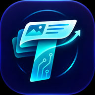

<p align="center">
  
</p>

<h1 align="center">TechMeku（テクメク）</h1>

<p align="center"><b>技術を、めくって発見する。</b></p>

Qiita・Zenn・note の技術記事を端末に保存し、オフラインでも上下スワイプで次々に読める Android アプリです（Flutter 製）。
興味タグに合った新着記事を「おすすめ」で流し読みでき、アプリ内で記事を投稿することもできます。投稿は 24 時間で消えますが、いいね・コメントで公開期間が延びます。

> [!NOTE]
> 現在は **開発中（テスト段階）** です。Google Play での配布はまだ行っていません。

## 主な機能

- **ホーム 3 タブ**：おすすめ ／ ストック ／ みんなの投稿。起動時にオフラインならストックを開きます
- **一括DL**：興味タグに沿って記事をまとめて端末に保存します（入れ替え方式）。未閲覧が残り 5 件になると自動で補充します
- **閲覧状態**：未閲覧 ／ 閲覧済 ／ 既読（全文を開いた）の 3 段階で管理します
- **投稿**：24 時間で消える短期公開です。いいね・コメントで延長でき、通報とモデレーションも備えています
- **プロフィール**：自分で保存した記事（ストック）と、いいねした記事

## 構成

| 項目 | 内容 |
|---|---|
| 対象 OS | Android（Google Play で公開予定） |
| クライアント | Flutter |
| サーバー | Cloudflare Workers + D1 + R2 + Cron Triggers + Access（無料枠のみで運用） |
| 認証 | Google ログイン（メールアドレス・氏名は保存しません） |

外部記事は端末から直接取得し、サーバーには保存しません。サーバーが扱うのは投稿・いいね・コメント・通報・認証だけです。

## リポジトリ構成

```
.
├── app/                      # Flutter アプリ（Android）
│   ├── lib/
│   │   ├── core/             # 設定値・テーマ・アイコン・端末DB・アプリ設定
│   │   ├── models/           # データモデル
│   │   ├── sources/          # Qiita / Zenn / note の取得アダプタ
│   │   ├── services/         # ストック・一括DL（入れ替え）・サーバーAPI・ログイン・定期DL
│   │   └── ui/               # 画面（S01〜S16）
│   ├── assets/               # アプリアイコン（brand）と UI アイコン（icons）
│   └── test/                 # ユニットテスト
├── server/                   # Cloudflare Workers（Hono + D1 + R2）
│   ├── src/                  # API・管理ページ・Cron
│   ├── migrations/           # D1 スキーマ
│   └── test/e2e.mjs          # API の E2E テスト（ローカル）
└── doc/
    ├── design.md             # 設計書
    ├── wireframes.html       # 全画面のワイヤーフレーム
    ├── api-verification.md   # 外部 API の検証結果
    ├── terms.md / privacy.md # 利用規約・プライバシーポリシー（ドラフト）
    └── icon/                 # アイコン一覧と画面ごとの対応表
```

## 開発

### アプリ（`app/`）

必要なもの：Flutter SDK、Android SDK（Android Studio）、Android 端末またはエミュレーター。

```sh
cd app
flutter pub get
flutter test                 # ユニットテスト
flutter run                  # 本番サーバー（techmeku-api.ryome-blog.workers.dev）につなぐ
flutter run --dart-define=API_BASE=http://10.0.2.2:8787   # エミュレーターからローカルの wrangler dev につなぐ
```

Google ログインは、Google Cloud の OAuth クライアント（Android・Web）にパッケージ名 `com.ryomeblog.techmeku` とビルドに使う署名の SHA-1 が登録されている必要があります。

### サーバー（`server/`）

必要なもの：Node.js、Wrangler、Cloudflare アカウント。

```sh
cd server
npm install
wrangler d1 migrations apply techmeku-db --local
wrangler dev --test-scheduled      # 別ターミナルで npm test（E2E テスト）
wrangler deploy                    # 本番へ
```

シークレット（`SERVER_SECRET` / `SESSION_SECRET` / `IP_SALT_SECRET`）は `wrangler secret put` で登録します。ローカルでは `server/.dev.vars`（コミットしない）に書きます。

管理ページ（`/admin`）は Cloudflare Access で保護します。`wrangler.jsonc` の `ACCESS_TEAM_DOMAIN` と `ACCESS_AUD` を設定するまでは常に 403 を返します。

## ドキュメント

- [設計書](doc/design.md)：仕様と実装設計。1〜3 章が確定した仕様、4〜9 章が実装設計です
- [ワイヤーフレーム](doc/wireframes.html)：ブラウザで開いてください（アイコンは `app/assets/` を参照するため、クローンしてから開きます）
- [外部 API の検証結果](doc/api-verification.md)
- [アイコン対応表](doc/icon/ICON_USAGE.md)

## ライセンス

[MIT License](LICENSE)

アプリで表示する外部記事の著作権は、それぞれの執筆者に帰属します。
